<div align="center">

# 💧 Maji

### Water delivered when you need it.

**A Nairobi water-delivery platform for customers, vendors and admins, with a read-only API for partner teams and a Health Journal that checks water-safety signals from SafeMeds.**

`React 18` · `Vite` · `Express 5` · `MySQL` · `Leaflet` · `JWT` · `OpenAPI 3` · `Jest`

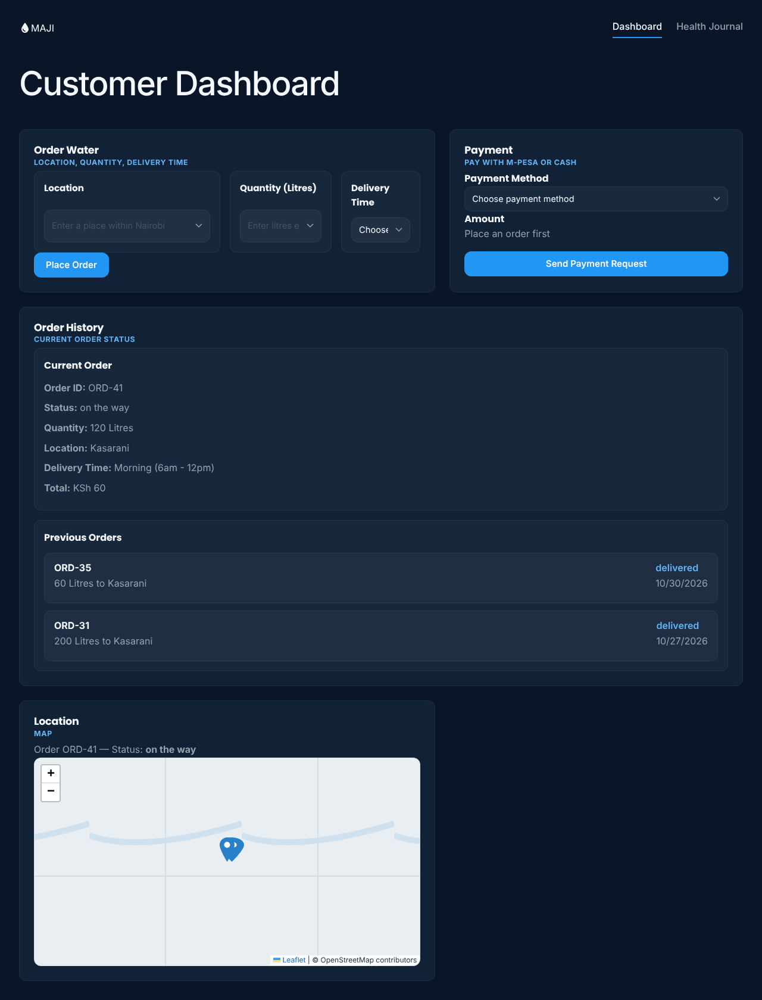

<sub>The customer dashboard. Screenshots in this README use sample data, and the map background is a placeholder (the real app loads OpenStreetMap tiles).</sub>

[For users](#part-1-for-users) · [For API consumers](#part-2-for-api-consumers) · [What the app claims, and what it does](#what-the-app-claims-and-what-it-actually-does) · [Frameworks](#frameworks-and-tools) · [Run it](#run-it-locally) · [Limits](#what-this-repository-does-not-claim)

<sub><b>Status:</b> course project (Team 4) · web app runs locally · API deployed on Render · 50 tests, 45 passing · M-Pesa, vendor matching and live tracking not built</sub>

</div>

---

> The most useful thing in this README is the table that separates what Maji *says* it does from what the code *does*. If you are about to demo, read it first.

## What is Maji?

Buying water in many Nairobi estates means calling a vendor and ordering a large quantity. Maji lets a customer order from **20 litres** and gives vendors and admins a place to see and manage those orders.

There are two audiences, and this README is split to match:

| You are... | Start here |
|---|---|
| A customer, vendor, admin, teacher or marker using the web app | [Part 1: For users](#part-1-for-users) |
| A developer on another team calling Maji's API (for example SkillsBridge) | [Part 2: For API consumers](#part-2-for-api-consumers) |

How the pieces connect:

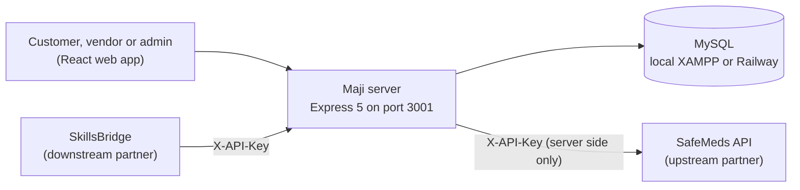

---

# Part 1: For users

## Pick a role

The app has three roles. Which pages you see depends on your role at login.

| Role | Where you land | What you can do |
|---|---|---|
| **Customer** | `/customer` | Place a water order, see your orders, open the Health Journal |
| **Vendor** | `/vendor/dashboard` | See your order queue and move orders through accept, on the way and delivered |
| **Admin** | `/admin` | See recent orders and vendors, total revenue, and the full order and vendor lists |

### Home, sign in and sign up

<p align="center">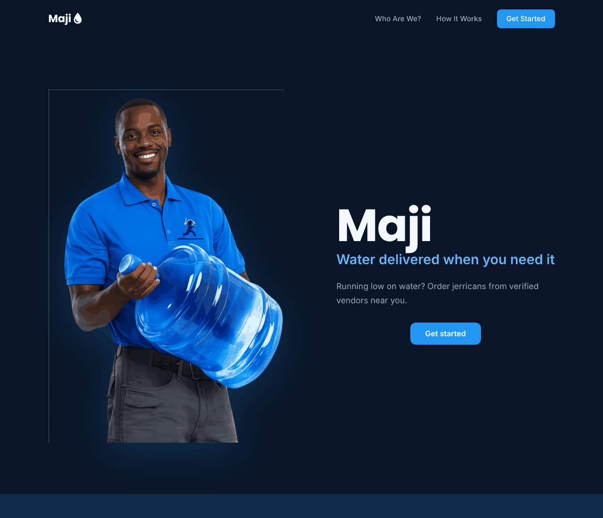 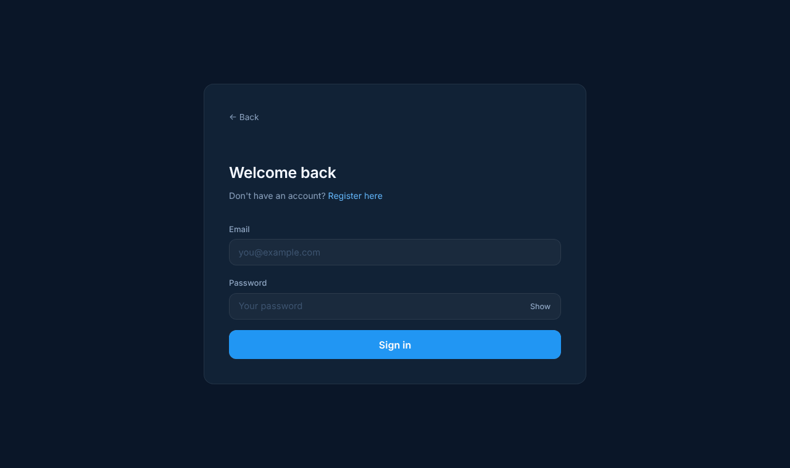</p>

New users choose **I need water** or **I'm a vendor** on the sign-up page:

<p align="center">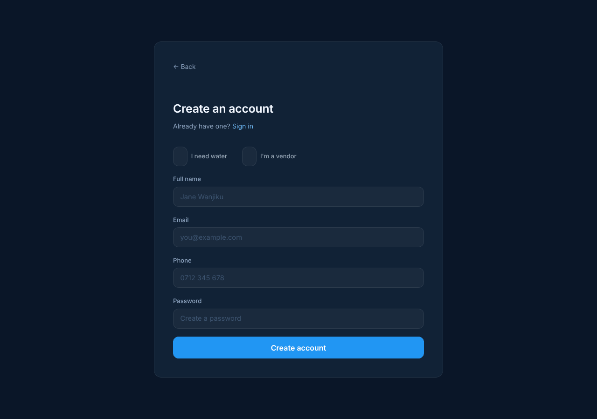 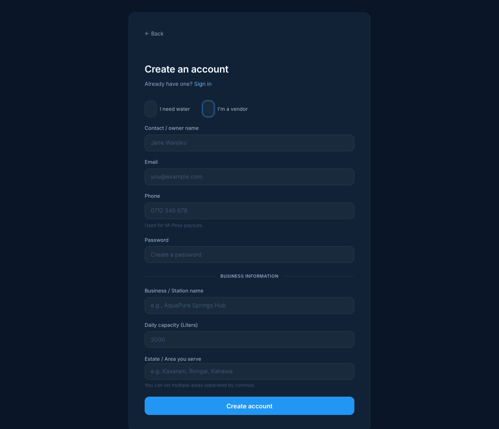</p>

> **Known issue.** Customer sign-up works. Vendor sign-up through this form is expected to fail on the server: the code inserts into `vendors` columns `daily_capacity` and `estates_served`, and no script in `db/` creates them (the insert also has five placeholders for four columns). See [the table below](#what-the-app-claims-and-what-it-actually-does).

## Customer

### Order water

Enter a place in Nairobi, a quantity from 1 to 10,000 litres and a delivery window (morning, afternoon or evening). **Place Order** saves the order as `pending`. The price is fixed in the code at **KSh 0.50 per litre**, and every order from this form is saved as `cash`.

The same page shows your **current order**, your **previous (delivered) orders**, and a **map**.

<p align="center"></p>

### Health Journal

The **Health Journal** tab (`/customer/health`) connects Maji to **SafeMeds**, the upstream partner team. It has four sections:

| Section | What it shows | Source |
|---|---|---|
| **In your area** | Waterborne illness alerts (cholera, typhoid) for your estate | SafeMeds `GET /v1/health-signals/area-alerts` |
| **Make it safe to drink** | The top-rated water-treatment products, with a sample review | SafeMeds `GET /reviews` |
| **Water treatment tablets in stock** | Products with quantity, and an **Order** button | SafeMeds `GET /inventory`, `POST /orders` |
| **Your treatment orders** | Orders you placed from this page | Maji's own `health_orders` table |

<p align="center">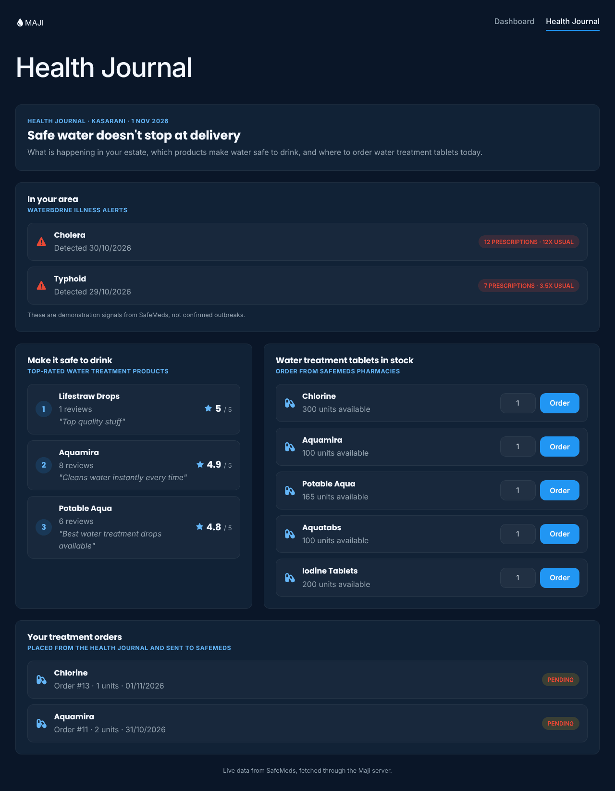</p>

Things to know:

- The alert signals are **demonstration data** from SafeMeds, and the page says so on screen. They are not confirmed outbreaks.
- The browser never talks to SafeMeds. The Maji server calls it, so the SafeMeds key stays on the server. If SafeMeds is down, each section shows its own "unavailable" notice instead of breaking the page.
- Treatment orders always show **Pending**. SafeMeds has no endpoint to read an order's status back.
- Your estate is taken from your most recent Maji order.

## Vendor

The vendor dashboard shows revenue, litres dispatched and active workload, an **order queue** with **Accept → On the Way → Mark Delivered** buttons, and a coverage map.

<p align="center">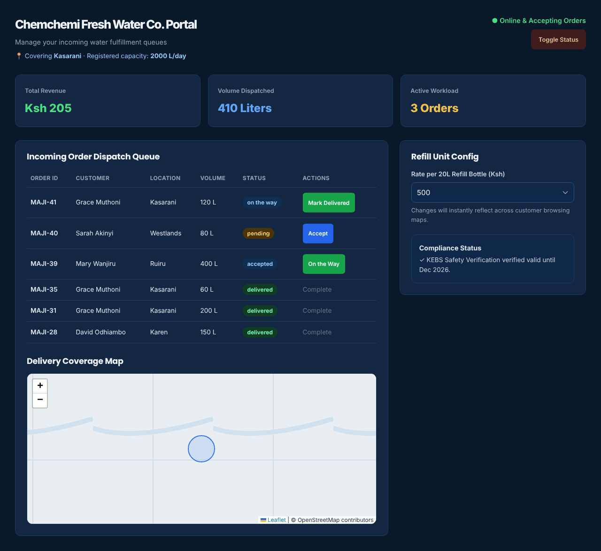</p>

A separate **vendor application form** (`/vendor/register`) collects business name, owner, phone, estate, capacity and terms:

<p align="center">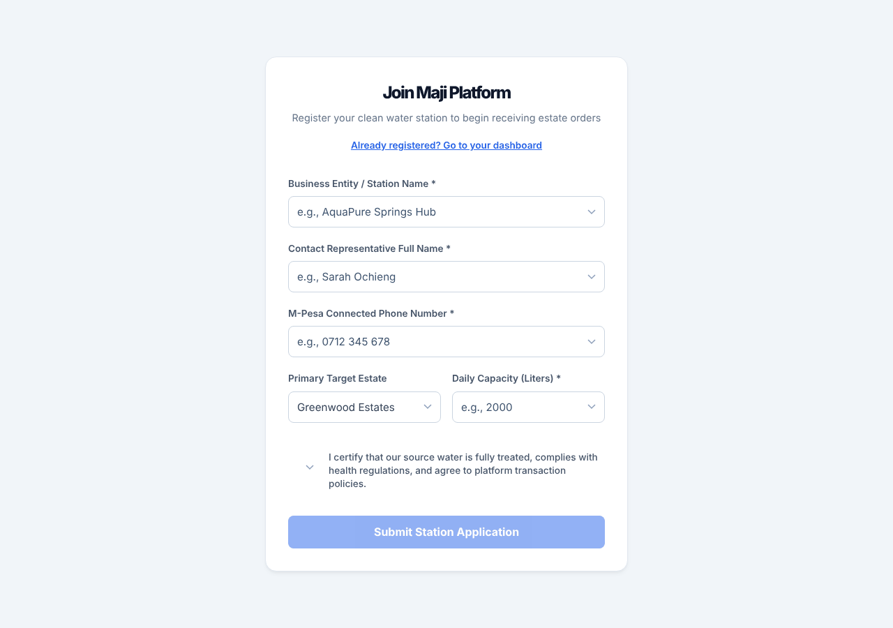</p>

> The application form saves to your **browser's local storage only**. It sends nothing to the server, and the success message ("an audit team will text you an activation code") is not backed by any process.

## Admin

<p align="center">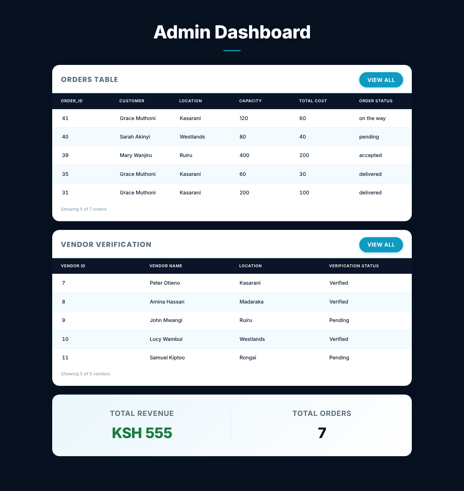</p>

The admin dashboard lists the latest orders and vendors, and **VIEW ALL** opens the full lists:

<p align="center">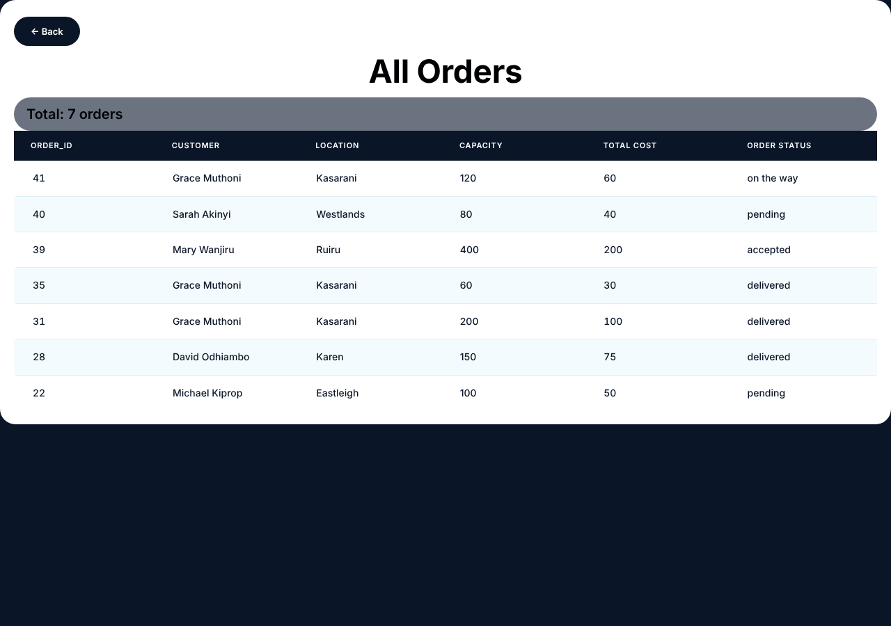 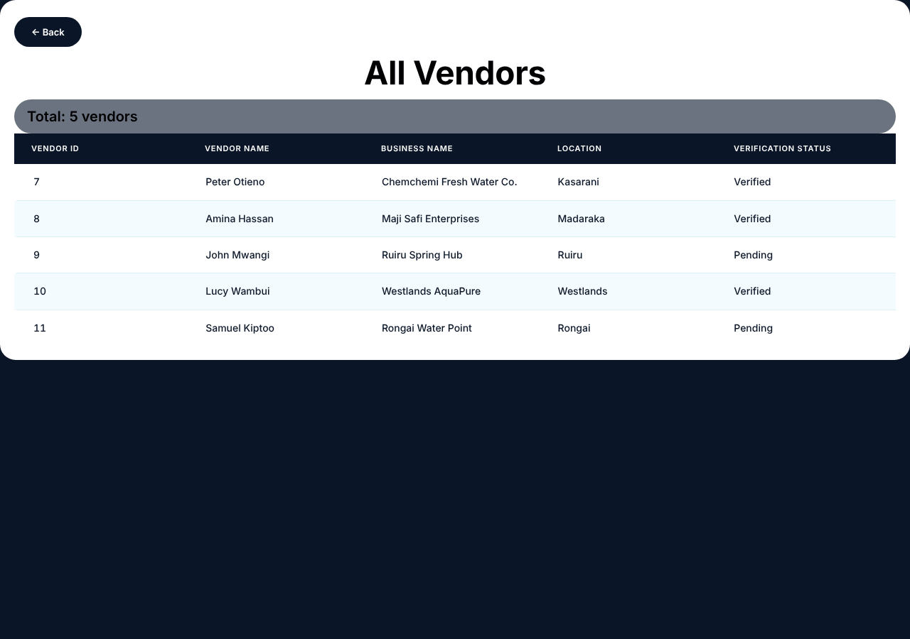</p>

Admins can **see** each vendor's verification status. There is no button in the web app to change it (the server has an endpoint for it, but nothing in the interface calls it).

---

## What the app claims, and what it actually does

The home page makes four promises, and the dashboards imply more. Here is each one, checked against the code.

| Claim | Status | What actually happens |
|---|---|---|
| **"Order jerricans from verified vendors near you"** | 🟡 Partly | Orders are saved with no vendor attached (`vendor_id` is `NULL`). The word "verified" is not enforced at order time. |
| **"You're matched with the nearest verified seller automatically"** | 🔴 Not built | There is no matching logic anywhere. New orders are not assigned to any vendor. |
| **"Track the delivery in real time"** | 🔴 Not built | The page shows the order's status as text and a map with a **single fixed marker in central Nairobi**. There is no GPS, route or live position. |
| **"Receive and rate"** | 🔴 Not built | There is no screen to submit a rating. The ratings in the database are **generated by a script** (`db/ratings.sql`), not given by customers. |
| **Order water from 20 litres** | ✅ Works | The form accepts 1 to 10,000 litres and saves the order, and the server validates it. |
| **"Pay with M-Pesa or cash"** | 🔴 Not built | The Payment panel is a mock-up: it shows a message and sends nothing. There is no M-Pesa integration. The panel is also not connected to the order form, so it asks you to "place an order first". Orders are always saved as cash. |
| **Vendors accept and deliver orders** | 🟡 Partly | The buttons work and the status is saved (`PATCH /api/orders/:id/status`). But the dashboard only lists orders whose `vendor_id` equals the vendor's user ID, and new orders have none, so a new order does not reach a vendor on its own. |
| **Vendor sign-up** | 🔴 Broken | See the known issue above. The separate application form saves only to the browser. |
| **Vendor "Toggle Status" and price per refill** | 🟡 Display only | Changes live in the page and are lost on refresh. The "KEBS Safety Verification" box is fixed text, not a real check. |
| **Admin verifies vendors** | 🟡 Partly | Status is shown, and the server can change it, but the web app has no verify button. |
| **Role-based access** | 🟡 Front end only | `/admin`, `/vendor/dashboard` and `/customer` check the role stored in your browser. The server's order and vendor endpoints require no login, and the app does not send its JWT with requests. See [`SECURITY_AUDIT.md`](SECURITY_AUDIT.md). |
| **Health Journal** | ✅ Works, with limits | Real calls to SafeMeds' API through Maji's server. Alerts are demo signals, and order status cannot be read back. See [`INTEGRATION_LOG.md`](INTEGRATION_LOG.md). |
| **API for SkillsBridge** | ✅ Works | Five read-only endpoints, protected by an API key and a rate limit. See [Part 2](#part-2-for-api-consumers). |

**Legend:** ✅ works · 🟡 partly or limited · 🔴 not built or broken.

---

# Part 2: For API consumers

Maji exposes **five read-only `GET` endpoints** for partner teams. **SkillsBridge** uses them to suggest skill-exchange sessions and water-vendor stations as meetup venues.

- **Base URL:** `https://maji-api-onrender-com.onrender.com/api`
- **Auth:** an `X-API-Key` header on every request. Ask the Maji team for a key.
- **Limit:** 100 requests per minute per key.
- **Format:** JSON arrays.
- **Full reference:** [`docs/API_REFERENCE.md`](docs/API_REFERENCE.md) · **Contract:** [`openapi.yaml`](openapi.yaml) · **Rendered docs:** [Redoc](https://redocly.github.io/redoc/?url=https://raw.githubusercontent.com/NgwonoJeremy/maji-website/main/openapi.yaml) · **Postman:** [`postman/`](postman/)

> **First request may be slow.** The API runs on Render's free tier and sleeps after about 15 minutes without traffic. The first call can take up to a minute.

## Quickstart

```bash
curl -H "X-API-Key: YOUR_API_KEY" https://maji-api-onrender-com.onrender.com/api/vendors/locations
```

You should get a JSON array of vendors:

```json
[
  { "vendorId": 1, "businessName": "Chemchemi Fresh Water Co.", "estate": "Kasarani" },
  { "vendorId": 2, "businessName": "Maji Safi Enterprises", "estate": "Madaraka" }
]
```

## Endpoints

| Method | Path | Returns | Parameters |
|---|---|---|---|
| `GET` | `/orders/active/estates` | Each estate with at least one active order | none |
| `GET` | `/orders/active/schedules` | Active delivery schedules | none |
| `GET` | `/vendors/top-rated` | The highest-rated verified vendor in each estate | none |
| `GET` | `/vendors/locations` | Each vendor's business name and estate | optional `estate` |
| `GET` | `/vendors/all` | All vendors | optional `estate` |

An empty `estate` value returns `400`. Examples and real sample responses for every endpoint are in the [full reference](docs/API_REFERENCE.md).

## Errors

| Situation | Status | Body |
|---|---|---|
| Key missing or wrong | `401` | `{ "error": "Missing or invalid API key" }` |
| Over 100 requests a minute | `429` | `{ "error": "Too many requests", "retryAfterSeconds": 42 }` plus a `Retry-After` header |
| Bad `estate` value | `400` | `{ "error": "estate must be a non-empty string" }` |
| Mistyped path | `404` | An HTML page, not JSON |

## What the API does not do

- It is **read-only**. Partners cannot create or change Maji data.
- It does not return customer details such as names or phone numbers.
- "Top-rated" uses ratings that were **generated by a script** for the seeded vendors, not real customer reviews.
- The data is the project's seeded test data (50 vendors, 50 orders), not a live marketplace.
- Keys are issued by hand, and there is no self-service sign-up or key rotation.

## Maji also calls an API: SafeMeds

Maji is a consumer too. The Health Journal calls SafeMeds through the Maji server, and the SafeMeds key never reaches the browser.

| Maji route (used by the web app) | Calls SafeMeds |
|---|---|
| `GET /api/health/alerts?estate=` | `GET /v1/health-signals/area-alerts` |
| `GET /api/health/products` | `GET /reviews` |
| `GET /api/health/stock` | `GET /inventory` |
| `POST /api/health/orders` | `POST /orders`, then saves a copy in `health_orders` |
| `GET /api/health/orders?customerId=` | reads `health_orders` |

Setup notes, the mapping and the open issues are in [`INTEGRATION_LOG.md`](INTEGRATION_LOG.md).

## Routes used by the web app (not for partners)

These power the React app and are **not protected by an API key**. Do not treat them as a public contract.

| Route | Used for |
|---|---|
| `POST /api/auth/register`, `POST /api/auth/login` | Sign up and sign in (returns a JWT) |
| `GET /api/orders`, `POST /api/orders`, `PATCH /api/orders/:id/status` | Orders |
| `GET /api/vendors`, `PATCH /api/vendors/:id/verify` | Vendors |

`GET /api/orders` returns every customer's orders, and the verify and status routes need no login. These are recorded as findings in [`SECURITY_AUDIT.md`](SECURITY_AUDIT.md).

---

## Frameworks and tools

| Layer | Used |
|---|---|
| **Front end** | React 18, Vite 6, React Router 7, Leaflet with react-leaflet (maps), Font Awesome icons |
| **Back end** | Node.js, Express 5, cors, dotenv |
| **Database** | MySQL (XAMPP / phpMyAdmin locally, Railway hosted), `mysql2` |
| **Auth** | bcryptjs password hashes, JSON Web Tokens (7 days) |
| **API security** | API-key middleware and an in-memory rate limiter ([`server/middleware/security.js`](server/middleware/security.js)) |
| **API docs** | OpenAPI 3 ([`openapi.yaml`](openapi.yaml)), Redoc, a Postman collection |
| **Testing** | Jest 30 and supertest, with the database mocked |
| **Quality** | ESLint 9 |
| **Hosting** | API on Render, database on Railway |

## Run it locally

Needs Node 22 and MySQL (XAMPP works).

**1. Install**

```bash
git clone https://github.com/NgwonoJeremy/maji-website.git
cd maji-website
npm install
```

**2. Create the database.** Make an empty database (for example `maji_platform`) in phpMyAdmin, open its **SQL** tab, paste [`db/railway_setup.sql`](db/railway_setup.sql) and click **Go**. It loads 100 customers, 50 vendors and 50 orders. Run it **once** on an empty database. For the Health Journal, also run [`db/health_orders.sql`](db/health_orders.sql).

**3. Create `.env`** (copy [`.env.example`](.env.example)):

```
DB_HOST=127.0.0.1
DB_PORT=3306
DB_NAME=maji_platform
DB_USER=root
DB_PASSWORD=
JWT_SECRET=any-long-random-string
PORT=3001
API_KEYS=skillsbridge:somekey
RATE_LIMIT_MAX=100
SAFEMEDS_URL=https://safemeds-majiapp-api-nate.onrender.com
SAFEMEDS_API_KEY=<key from SafeMeds>
```

Never commit `.env`. Without `API_KEYS`, the partner endpoints reject every request. Without `SAFEMEDS_API_KEY`, the Health Journal sections show "unavailable".

**4. Start the server and the app** (two terminals)

```bash
npm run server     # API on http://localhost:3001
npm run dev        # web app on http://localhost:5173
```

The server only accepts browser requests from `http://localhost:5173`.

**5. Run the tests**

```bash
npm test
```

Currently 50 tests: 45 pass and 5 fail. The 5 failures are the `PUT /api/customers/:id` and vendor `PUT`/`DELETE` routes, which do not validate their input yet.

## Repository map

| Path | Contents |
|---|---|
| `src/` | React app: `Pages/` (customer, vendor, admin, auth, home), `components/`, `styles/` |
| `server/` | Express app: `routes/` (auth, orders, vendors, health), `apis.js` (partner API), `middleware/security.js`, `db.js` |
| `db/` | SQL scripts: `railway_setup.sql` (full setup), `health_orders.sql`, and smaller seed files |
| `__tests__/` | Jest and supertest tests |
| `docs/` | `API_REFERENCE.md` and the screenshots used here |
| `openapi.yaml`, `postman/` | The API contract and Postman tests |
| `INTEGRATION_LOG.md` | The SafeMeds integration: mapping, issues, decisions |
| `SECURITY_AUDIT.md` | The Week 9 API security review and its open findings |
| `Team_Charter.md` | Team roles and what each dashboard should contain |

## What this repository does not claim

- Automatic vendor matching, delivery tracking, a live driver location or delivery times.
- M-Pesa (or any real) payment. There is no payment provider integration.
- Customer ratings or reviews of vendors. The shown ratings are seeded.
- Working vendor sign-up through the app.
- Verified vendors in any enforced sense: the status is a database field that the web app cannot change.
- Server-side access control on the web app's own routes. Only the five partner endpoints need a key.
- A deployed web front end. The server is set up for `localhost:5173`.
- Real health signals. SafeMeds' alerts are demonstration data, and Maji does not give medical advice.

## The team

**Team 4** (see [`Team_Charter.md`](Team_Charter.md)): Marie-Ange (API lead), John Mwangi (DevOps and docs lead), David Mukoya (integration and QA lead), Jeremy Raphael (back-end developer).

**Ring position:** SafeMeds (Team 3) → **Maji (Team 4)** → SkillsBridge (Team 5). Maji consumes SafeMeds' API and produces an API for SkillsBridge.

<p align="center"><sub><b>Maji</b> · water delivered when you need it · the orders are real, the matching, tracking and payment are still ahead.</sub></p>
