# Week 11 Evidence: Resilience Tests

Maji Platform, Health Journal page (`/customer/health`). Partner API: SafeMeds. Tests run on 4 Nov 2026.

This document collects the screenshots from the resilience tests. **All tests below used a stand-in partner** (`flaky-partner.js` on port 4000) that can be switched between normal, slow, flaky and error modes. The page footer reads "Live data from SafeMeds" in the page screenshots, but the data came from the stand-in, not the real SafeMeds server.

| Setting | Value |
|---|---|
| Normal response time (stand-in) | 0.0037 s (0.003737 s and 0.003563 s) |
| Timeout per try | 1500 ms |
| Retries | 2 (3 tries in total), GET requests only |
| Wait between tries | 200 ms, then 400 ms |
| Worst-case wait | 3 x 1500 + 200 + 400 = 5100 ms |
| Fallback | Last good response kept in server memory, shown with a banner; friendly message if nothing is saved |

## 1. Before the fix (Week 10 code)

The baseline: how fast the partner answers normally, and what happened when it was slow.

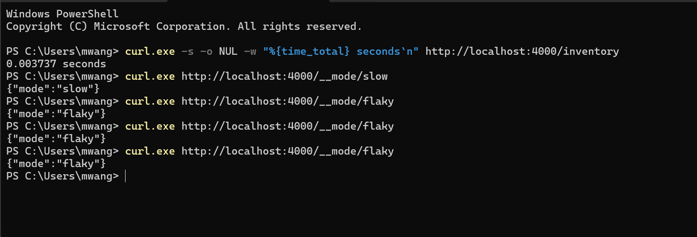

**Figure 1.** Normal speed: a call to the stand-in's `/inventory` took 0.003737 s. The lines below switch the stand-in to slow and flaky mode.

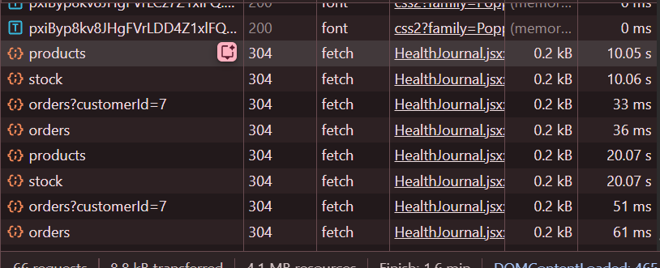

**Figure 2.** Slow partner, no timeout: the products and stock requests took 10.05 s and 10.06 s, and a reload while waiting stacked up to 20.07 s. The page gave no message while it waited.

## 2. After the fix: retries and timeout

Each failing request is retried exactly twice, waiting 200 ms and then 400 ms, then stops.

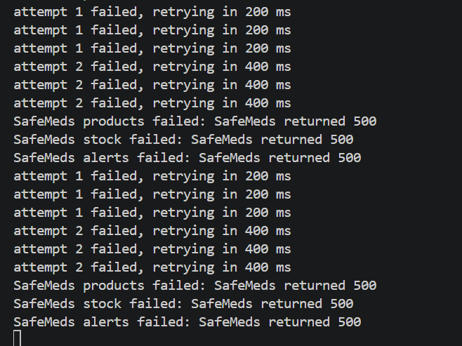

**Figure 3.** Error mode (partner always returns 500), two page loads. Each of the three sections shows attempt 1 (200 ms) and attempt 2 (400 ms), then `SafeMeds products / stock / alerts failed: SafeMeds returned 500`. There is no third retry.

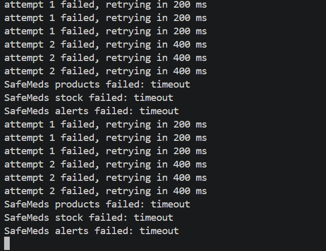

**Figure 4.** Slow mode (partner answers after 10 s), two page loads. Every try is cut off by the 1.5 s timeout: two retries per section, then `failed: timeout` for products, stock and alerts.

## 3. Flaky partner (fails twice, then works)

The user never sees the failure: the retries absorb it and the page loads live data.

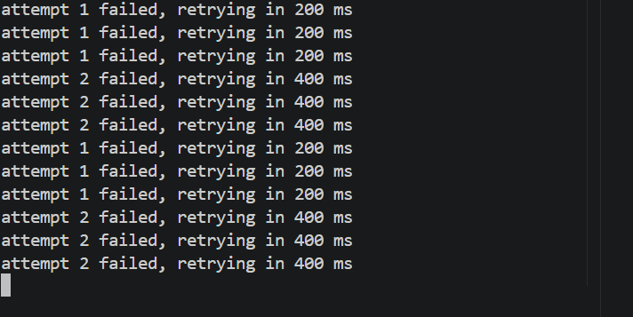

**Figure 5.** Maji server log in flaky mode, two page loads. Each section logs attempt 1 (200 ms) and attempt 2 (400 ms), and there is no `failed:` line, so every request succeeded on its third try.

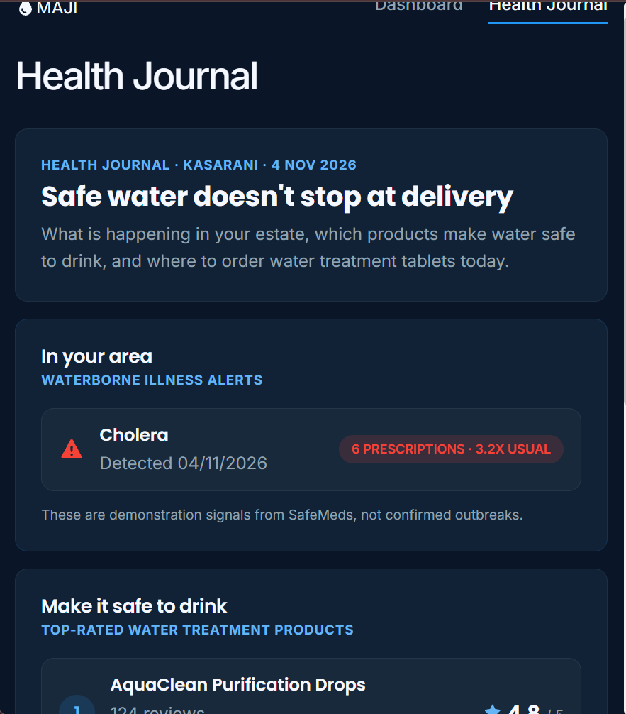

**Figure 6.** Health Journal in flaky mode (top): the alert section shows live data with no banner and no error message.

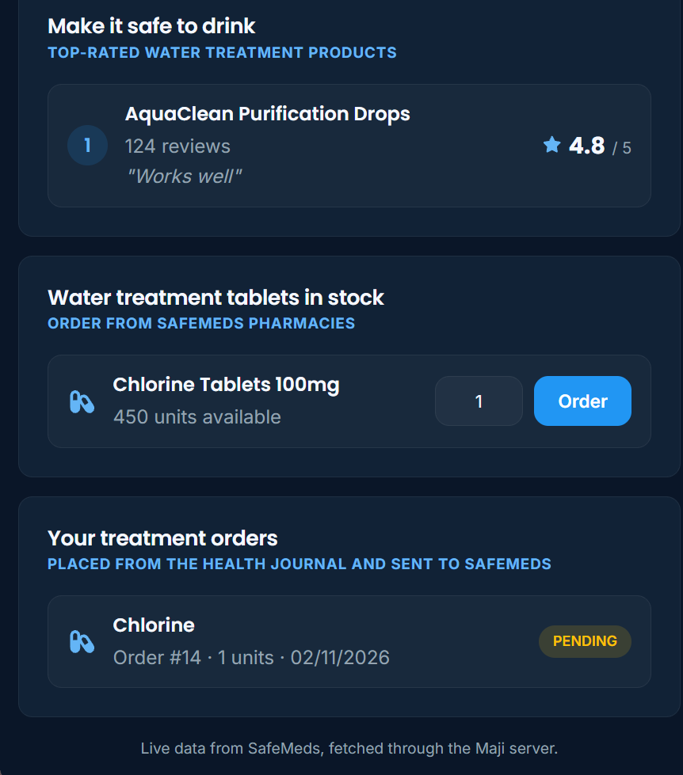

**Figure 7.** Health Journal in flaky mode (bottom): products, stock and the customer's orders all show live data.

## 4. Partner failing and nothing saved

After a server restart there is no saved copy, so the page shows a friendly message instead of data.

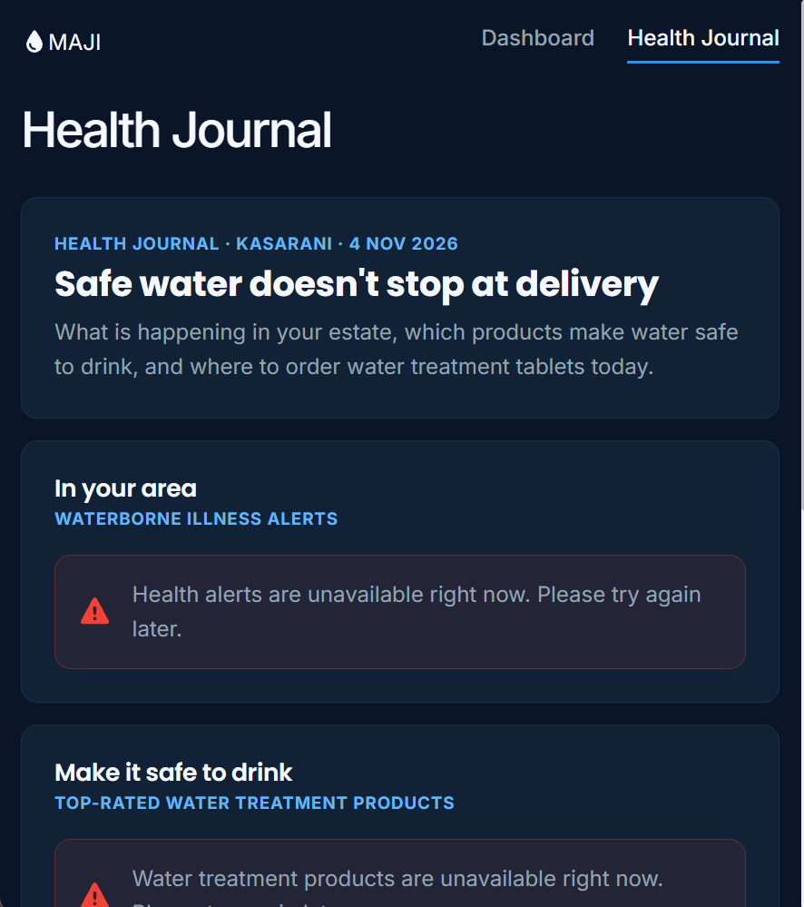

**Figure 8.** Slow mode after restarting the Maji server (top): the alerts and products sections show "unavailable right now. Please try again later." The page did not crash or go blank.

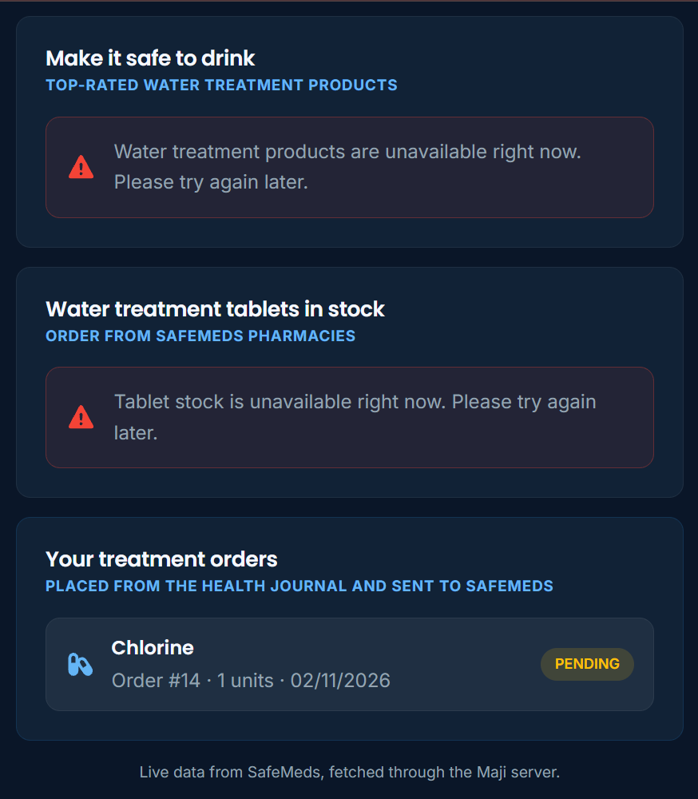

**Figure 9.** Same state (bottom): the tablet stock section is unavailable, while "Your treatment orders" still loads because it reads Maji's own database.

## 5. Partner failing with a saved copy

When SafeMeds fails after one good load, the server returns the saved response flagged as stale, and the page shows a banner.

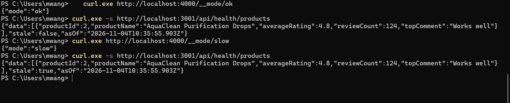

**Figure 10.** Server proof, without restarting Maji. With the stand-in normal, `/api/health/products` returned `"stale":false` with `asOf` 2026-11-04T10:35:55.903Z. After switching to slow mode, the same request returned the same data with `"stale":true` and the same `asOf`, so it came from the saved copy.

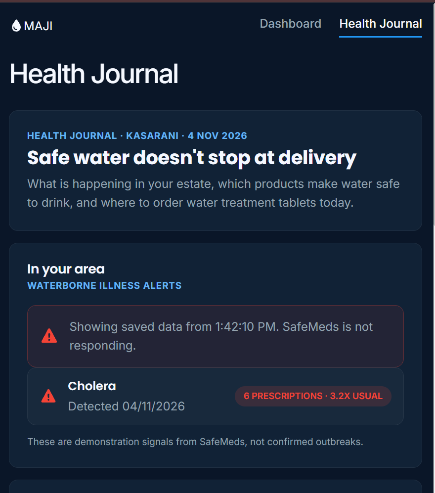

**Figure 11.** Banner in the browser (top): "Showing saved data from 1:42:10 PM. SafeMeds is not responding." appears above the alert, with the saved alert still shown.

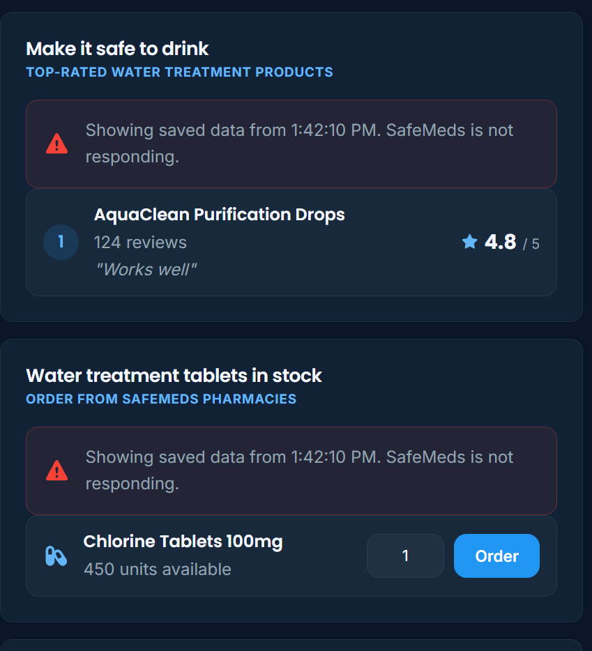

**Figure 12.** Banner in the browser (middle): the same banner appears in the products and tablet stock sections, above the saved data.

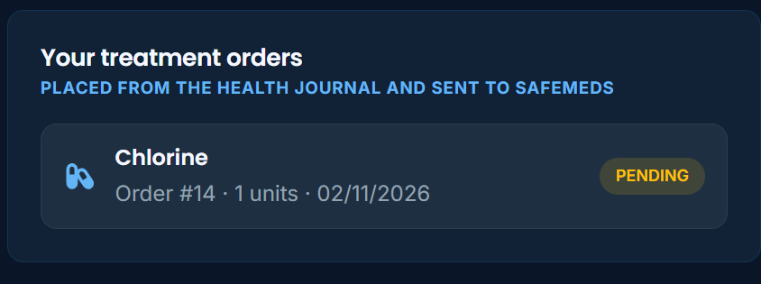

**Figure 13.** Banner state (bottom): the customer's treatment orders are unaffected, because they do not depend on SafeMeds.